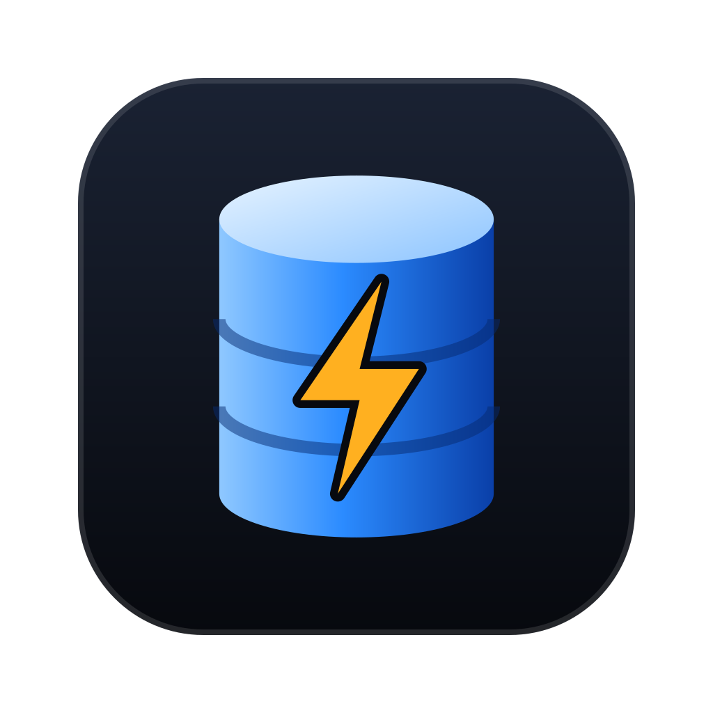
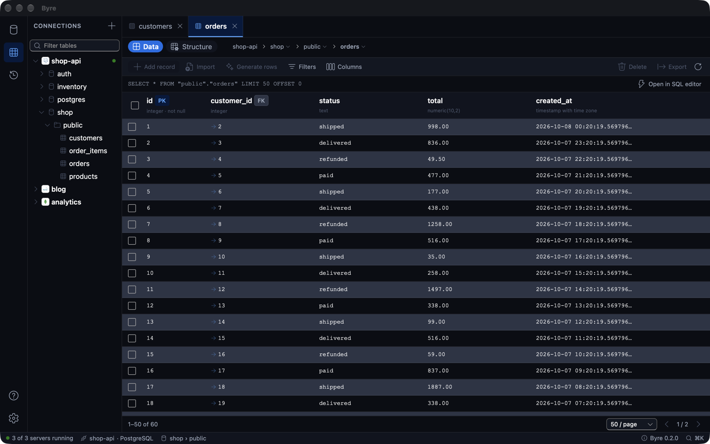
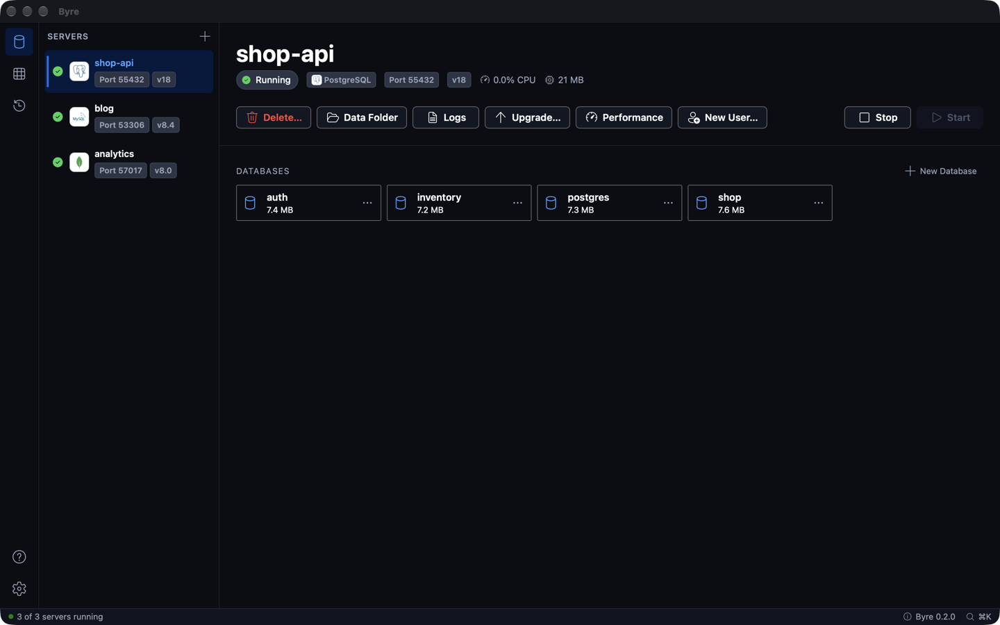
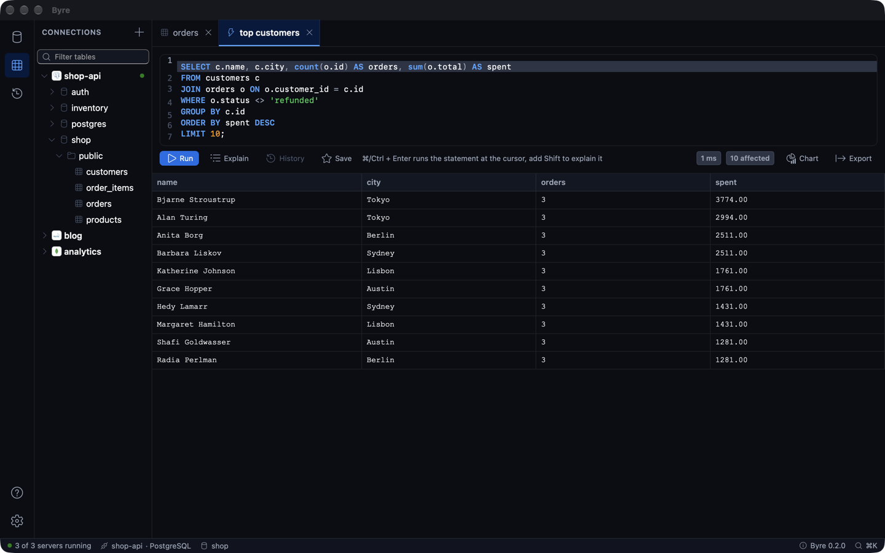

<p align="center">
  
</p>

<h1 align="center">Byre</h1>

<p align="center">
  <b>Local databases and a database studio in one desktop app.</b><br>
  Run PostgreSQL, MySQL and MongoDB side by side, and browse PostgreSQL, MySQL, MariaDB,
  MongoDB, Redis, SQLite and Turso from one place.
</p>

<p align="center">
  <a href="https://byre.app/download"><b>Download</b></a> ·
  <a href="https://byre.app">Website</a> ·
  <a href="https://byre.app/docs">Docs</a> ·
  <a href="https://byre.app/changelog">Changelog</a>
</p>

<p align="center">
  
</p>

## Download

Get the latest version from [byre.app/download](https://byre.app/download), or pick a file from
the [latest release](https://github.com/byreapp/byre-releases/releases/latest).

| Platform | File | Notes |
| --- | --- | --- |
| macOS, Apple silicon | [`Byre-mac-apple-silicon.dmg`](https://github.com/byreapp/byre-releases/releases/latest/download/Byre-mac-apple-silicon.dmg) | M1 and later |
| macOS, Intel | [`Byre-mac-intel.dmg`](https://github.com/byreapp/byre-releases/releases/latest/download/Byre-mac-intel.dmg) | Intel-based Macs |
| Windows | [`Byre_<version>_x64-setup.exe`](https://github.com/byreapp/byre-releases/releases/latest) | Windows 10 and 11, 64-bit |
| Windows (MSI) | [`Byre_<version>_x64_en-US.msi`](https://github.com/byreapp/byre-releases/releases/latest) | For managed installs |
| Linux, AppImage | [`Byre_<version>_amd64.AppImage`](https://github.com/byreapp/byre-releases/releases/latest) | Most distributions, 64-bit |
| Linux, Debian / Ubuntu | [`Byre_<version>_amd64.deb`](https://github.com/byreapp/byre-releases/releases/latest) | Ubuntu 22.04 or later |
| Linux, Fedora / RHEL | [`Byre-<version>-1.x86_64.rpm`](https://github.com/byreapp/byre-releases/releases/latest) | Fedora, RHEL, openSUSE |

Each file has a matching `.sig` signature, which the in-app updater checks.

## Install

### macOS

1. Open the DMG and drag **Byre** into **Applications**.
2. Open Byre. If macOS says it can't check Byre for malware, right-click Byre in
   **Applications** and choose **Open**, or press **Open Anyway** in
   **System Settings → Privacy & Security**. You only need to do this once.

### Windows

Run the installer (`-setup.exe`) or the MSI. The Windows build isn't code-signed yet, so
SmartScreen may warn the first time: choose **More info → Run anyway**.

When you uninstall, Byre asks whether to also delete the databases you created. Choose **No**
to keep them.

### Linux

```sh
# AppImage
chmod +x Byre_*_amd64.AppImage
./Byre_*_amd64.AppImage

# Debian / Ubuntu
sudo apt install ./Byre_*_amd64.deb

# Fedora / RHEL / openSUSE
sudo dnf install ./Byre-*.x86_64.rpm   # or: sudo zypper install ./Byre-*.x86_64.rpm
```

The first launch walks you through choosing a storage folder, downloading an engine and creating
your first server. See [Install Byre](https://byre.app/docs/install) for the full guide.

## Updates

Byre updates itself. It checks for a new version each time it opens and shows what's new; press
**Install and Restart**, or **Later** to skip it for now. You can check any time in
**Settings → About → Check for updates**. Your servers keep running while Byre restarts.

Every release's notes are in the [changelog](https://byre.app/changelog) and on the
[releases page](https://github.com/byreapp/byre-releases/releases).

## Features



- **Local Database.** Real PostgreSQL, MySQL and MongoDB servers without Docker or Homebrew,
  several versions side by side, each with its own data folder and port.
- **Database Studio.** Browse and edit local and cloud databases in a spreadsheet-style grid,
  with a SQL editor, table structure, ER diagrams and schema compare.
- **AI agents.** Let Claude Code, Cursor, Codex and other agents manage your local databases.
- **Menu bar.** Byre keeps running when you close the window; start and stop servers from the
  menu bar.



## Report a bug or request a feature

[Open an issue](https://github.com/byreapp/byre-releases/issues/new/choose) and pick
**Bug report** or **Feature request**. Please search
[existing issues](https://github.com/byreapp/byre-releases/issues?q=is%3Aissue) first.

For bugs, include your version info. In Byre, open **Settings → About → Copy version info** and
paste it into the issue. See [CONTRIBUTING.md](CONTRIBUTING.md) for more.

## Security

Please don't report security problems in a public issue. Use
[private vulnerability reporting](https://github.com/byreapp/byre-releases/security/advisories/new)
instead. See [SECURITY.md](SECURITY.md).

---

This repository holds Byre's signed releases, the updater feed (`latest.json`) and user issues.
Byre is commercial software and its source code is not public.
